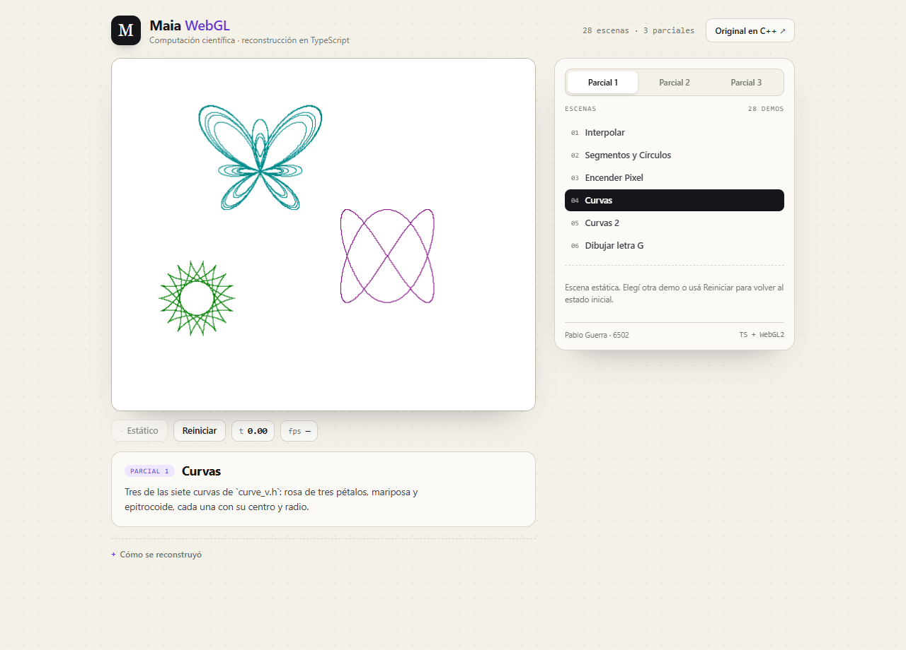

# Maia WebGL

Reconstrucción en **TypeScript + WebGL2** del proyecto
[Maia C++](https://github.com/SiddharthaGF/maia-c-plus-plus), el trabajo de
Computación Científica de Pablo Guerra (6502): un lienzo de 600×500 con 28
escenas de cálculo, curvas, texturas, ondas, 3D y simulación.

Sin frameworks de UI y sin dependencias de runtime: un renderer WebGL2 propio,
un registro de escenas y un shell de controles en DOM.



## Qué conserva y qué cambia

El original era una app Qt Widgets que encendía píxeles sobre un `QImage` de
600×500. La reconstrucción mantiene el tamaño del lienzo, la escala de 30 px por
unidad y las fórmulas de cada demo, pero:

- **Centra el plano**: x ∈ [−10, 10], y ∈ [−8.33, 8.33]. El original arrancaba
  en x ∈ [−0.5, 19.5], y ∈ [−0.5, 16.16], con el origen en la esquina inferior
  izquierda, lo que recortaba curvas, reflexiones y todo el 3D contra los bordes.
- **Evalúa los campos en la GPU**: ondas, interferencias, texturas y degradados
  se calculan por píxel en un fragment shader, con el índice entero `(i, j)` y
  la paleta del original.
- **Dibuja las primitivas como líneas de 1 px** en espacio de pantalla, con
  redondeo a píxel y deduplicación (el equivalente a `setPixelColor`). El 3D usa
  la proyección axonométrica del original (α = 45°, p = 0.5).
- **Agrega interacción**: play/pausa, reinicio, velocidad, sliders de amplitud,
  frecuencia y velocidad de fase, tablas de valores en HTML y exportación CSV.
- **No usa _frame skipping_**: la animación es continua a `requestAnimationFrame`
  y los campos se evalúan completos en cada frame.

## Correr el proyecto

Requiere Node ≥ 20.19 y un navegador con WebGL2.

```bash
npm install
npm run dev        # http://localhost:5180
npm run build      # typecheck + bundle en dist/
npm test           # 43 tests unitarios
npm run check      # typecheck + tests
```

El bundle de producción ronda los **38 kB de JS** (13 kB gzip) y **11 kB de CSS**.
No hay dependencias de runtime.

## Arquitectura

```
src/
  core/
    viewport.ts     mundo ↔ pantalla, proyección axonométrica
    palette.ts      paletas SVG, degradados y caché de colores
    plot.ts         acumulador de polilíneas/puntos en píxeles
  gl/
    shaders.ts      GLSL ES 3.00: campos por píxel + líneas
    renderer.ts     context, programas, paleta como textura 1D
  primitives/
    curves.ts       7 curvas de curve_v.h + Lagrange
    waves.ts        ondas 2D/3D e interferencias (tablas y tests)
    string.ts       serie de Fourier de la cuerda vibrante
    pandemics.ts    logística, RK4 y solución analítica
  scenes/
    parcial1.ts     6 escenas de primitivas
    parcial2.ts     9 escenas de cálculo y texturas
    parcial3.ts     13 escenas 3D, ondas y simulación
    index.ts        registro, búsqueda por id y tab
    helpers.ts      ejes, plataforma, CSV, tablas
  ui/
    app.ts          transporte, parámetros, router por hash
    table.ts        modal de datos y descarga CSV
  style.css         sistema visual (papel, tinta, acento violeta)
```

El renderer tiene dos pipelines:

1. **Campo**: un triángulo full-screen y un fragment shader que reconstruye el
   mundo desde `gl_FragCoord`, evalúa la fórmula y elige un color de la paleta
   (textura de 16×1 con `texelFetch`).
2. **Primitivas**: un VBO interleaved `x, y, r, g, b` en píxeles; `gl.LINES`
   para trazos y `gl.POINTS` para las nubes 3D.

La UI se enlaza por hash (`#/onda-3d`, `#/pandemia-rk05`), así que cada escena
es enlazable y recargable.

## Las 28 escenas

### Parcial 1 — primitivas

| # | Escena | Qué muestra |
|---|--------|-------------|
| 1 | Interpolar | degradado verde→rojo por columna |
| 2 | Segmentos y Círculos | 3 segmentos y 3 circunferencias |
| 3 | Encender Pixel | parábola y recta |
| 4 | Curvas | rosa, mariposa y epitrocoide |
| 5 | Curvas 2 | tres rosetones de cuatro pétalos |
| 6 | Dibujar letra G | la G de píxeles del original |

### Parcial 2 — cálculo y animación

| # | Escena | Qué muestra |
|---|--------|-------------|
| 1 | Curvas | 2^t, parábola, log, seno y cúbica |
| 2 | Taylor | 3^t vs. su polinomio de grado 4 |
| 3 | Curva Interpolada | Lagrange por 7 puntos de 3·cos(x/2) |
| 4 | Recta Tangente | tangentes a y = −0.03x² + 3 |
| 5 | Texturas | 8 patrones de píxel (selector) |
| 6 | Textura (degradado) | franjas con paleta degradada de 15 colores |
| 7 | Animar Pelota | trayectoria por tramos de 3 parábolas |
| 8 | Reflexión | ley de reflexión con normal y pelota animada |
| 9 | Curvas de nivel | familia y = k·e^(−4t) |

### Parcial 3 — 3D y simulación

| # | Escena | Qué muestra |
|---|--------|-------------|
| 1 | Vector 3D | hélice paramétrica axonométrica |
| 2 | Ecuaciones 3D | tubo helicoidal, esfera y toro |
| 3 | Onda simple | campo 2D con foco central |
| 4 | Interferencia | tres focos (paleta de 16 colores) |
| 5 | Animación Onda Simple | onda 2D animada |
| 6 | Animación Interferencia | interferencia animada |
| 7 | Onda Simple 3D | malla de 181×141 puntos sobre plataforma |
| 8 | Interferencia 3D | dos focos en (0, ±3) |
| 9 | Plataforma 3D | la plataforma de referencia |
| 10 | Cuerda Vibrante | Fourier con 40 armónicos |
| 11 | Pandemia RK 0.5 | RK4, h = 0.5, γ = 0.0011 |
| 12 | Pandemia Analítico | solución exacta, γ = 0.0013 |
| 13 | Pandemia RK 1 | RK4, h = 1, γ = 0.0011 |

## Mapa desde el C++

| Original | Reconstrucción |
|----------|----------------|
| `vector.h` (`screen`, `card`) | `core/viewport.ts` |
| `vector.h` (`setPixelColor`) | `core/plot.ts` |
| `segment.h`, `circuference.h` | `Plot.segment`, `Plot.circle`, `circlePoints` |
| `vector3d.h` | `viewport.axonometry` + `point3D` |
| `wave.h` | `primitives/waves.ts` + shader de campo |
| `wave3d.h` | `primitives/waves.ts` + escena de malla |
| `curve_v.h` | `primitives/curves.ts` |
| `vibrant_string.h` | `primitives/string.ts` |
| `Timer.h` + `QTimer` | loop de `requestAnimationFrame` en `ui/app.ts` |
| `mainwindow.cpp` (26 slots) | `scenes/*` + `ui/app.ts` |
| `mainwindow.ui` (3 tabs) | tabs y lista de escenas en `index.html` |

## Correcciones documentadas

Estas desviaciones buscan que la idea se vea y se entienda; están aisladas y
cubiertas por tests cuando son matemáticas:

1. **Plano centrado.** Con el mapeo original, la onda 3D, la plataforma
   (y ∈ [−8, −3.67]) y varias curvas quedaban fuera del lienzo. El origen ahora
   está en (300, 250) y la escala es 30 px/unidad en ambos ejes.
2. **`Segment3D`**: el original asignaba `vec.y0 = ... z ...` dos veces; acá la
   `z` se proyecta como corresponde.
3. **Índices de paleta**: en C++ `(int)fmod(...)` podía ser negativo o superar
   el tamaño del vector. En el shader se usa `abs`/`mod` y se recorta al tamaño
   real de la paleta.
4. **Dominio de `log`**: las curvas logarítmicas se muestrean solo en x > 0.
5. **Curva interpolada**: el original dibujaba una parábola y un foco sin usar.
   Se implementó el polinomio de Lagrange que la escena prometía.
6. **Cuerda vibrante**: el original calculaba coeficientes con Simpson
   evaluando f solo en l/2 y l, lo que producía amplitudes que no decaían y
   dibujaba fuera del lienzo. Se usa el perfil triangular de una cuerda pulsada
   f(x) = 1.5·min(x, l−x) y los coeficientes analíticos de la ecuación de onda.
7. **Reflexión**: el punto de incidencia original estaba en y = −8.33, fuera
   del canvas. Se reubicó sobre el eje x conservando la ley de reflexión.
8. **Simulación de pandemia**: los ejes y el escalado se centraron para ocupar
   el lienzo; los datos, γ, h y el método son los del original.
9. **Sin _frame skipping_**: el original alternaba `stepX = 700` para dibujar
   un frame de cada dos. La GPU no lo necesita.
10. **Tablas**: en lugar de un `QTableWidget` de 300 000 celdas y archivos
    `datos 2d.txt`, se muestra una vista parcial y se exporta el CSV completo.

## Verificación

```bash
npm run check   # tsc --noEmit + 43 tests
npm run build   # bundle de producción
```

Los tests cubren el mapeo cartesiano, las paletas, el deduplicado de píxeles,
las 7 curvas y Lagrange, las ondas 2D/3D, la cuerda de Fourier, RK4 vs. la
solución analítica y un smoke test que renderiza las 28 escenas verificando que
no haya NaN y que todas produzcan salida.

## Créditos

- Proyecto original: [SiddharthaGF/maia-c-plus-plus](https://github.com/SiddharthaGF/maia-c-plus-plus)
  (Pablo Guerra, 6502).
- Reconstrucción: TypeScript, WebGL2 y DOM, sin dependencias de runtime.
